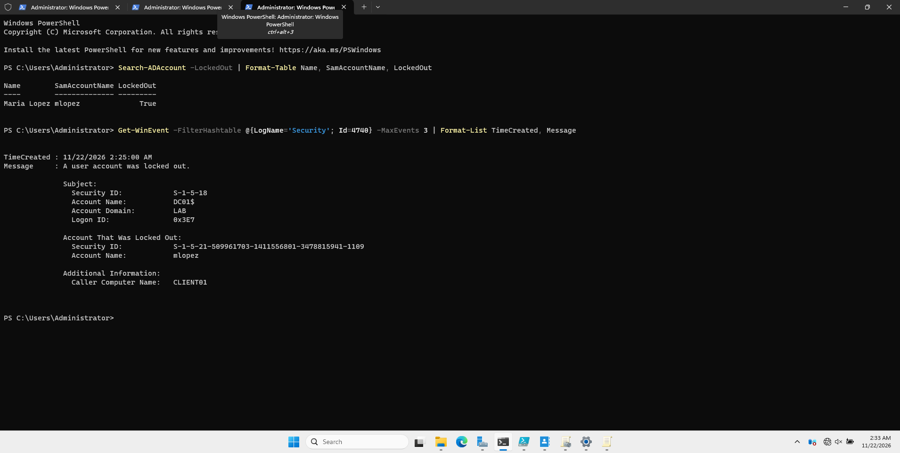
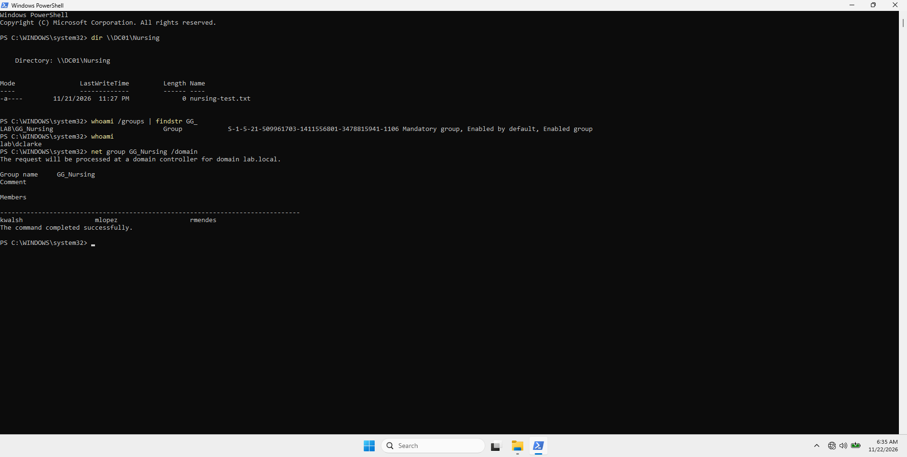
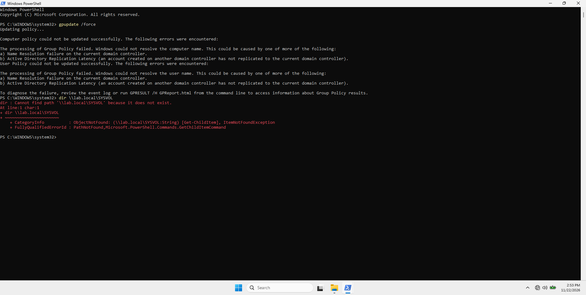
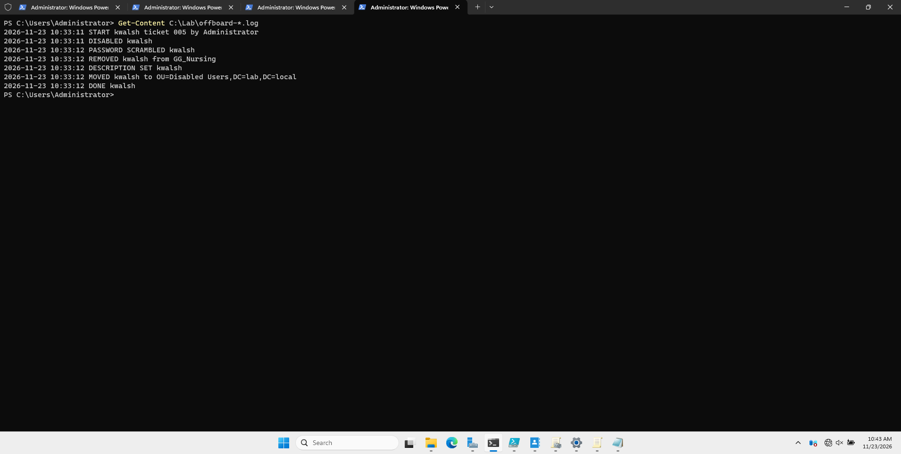

# Active Directory Home Lab

A small Windows domain built from scratch on VirtualBox to practice the day-to-day work of an IT support / sysadmin role: building a domain, managing users and groups with PowerShell, enforcing security with Group Policy, securing file shares, and working real help desk tickets end to end.

Everything is documented with screenshots, scripts and ticket write-ups.

## At a glance

| | |
|---|---|
| **Domain** | `lab.local` (NetBIOS `LAB`) |
| **DC01** | Windows Server 2025: AD DS, DNS, DHCP, file server (`192.168.56.10`) |
| **CLIENT01** | Windows 11 Enterprise LTSC 2024, domain-joined (DHCP `192.168.56.100`) |
| **Host** | Kali Linux running VirtualBox 7.2 |
| **Network** | Isolated host-only network for the lab, NAT adapter for updates only |

```
            Kali Linux host (VirtualBox 7.2)
  ┌──────────────────────────────────────────────┐
  │   Host-only network 192.168.56.0/24           │
  │                                                │
  │   ┌──────────────┐        ┌──────────────┐    │
  │   │    DC01      │◄──────►│   CLIENT01   │    │
  │   │ AD DS / DNS  │  DNS,  │  Windows 11  │    │
  │   │ DHCP / Files │ Kerb., │  domain      │    │
  │   │ .56.10       │ SMB    │  member .100 │    │
  │   └──────────────┘        └──────────────┘    │
  └──────────────────────────────────────────────┘
```

## What I built

**Active Directory and DNS/DHCP**
- Promoted DC01 to a new forest (`lab.local`) with integrated DNS.
- Authorized DHCP on the DC and configured the scope options so clients get DC01 as their DNS server.
- Renamed the DC after promotion with `netdom` and verified health with `dcdiag`.

**Users, groups and OUs (PowerShell)**
- OU structure: `Staff` with one OU per department, plus `Disabled Users`.
- Department security groups (`GG_<Department>`), following the AGDLP model.
- Bulk-created 12 users from a CSV with [`New-LabUsers.ps1`](scripts/New-LabUsers.ps1). It's idempotent (skips existing users), forces a password change at first sign-in, adds each user to their department group, and logs every action.
- Fixed a CSV header typo after import with [`Repair-LabUserNames.ps1`](scripts/Repair-LabUserNames.ps1), which corrected surnames, display names and object names in place.

**Group Policy** ([details](gpo/README.md), with full HTML reports)
- Domain password policy (12+ characters) and account lockout (5 attempts, 15 minutes).
- Workstation security baseline: logon banner, 10-minute inactivity lock, removable storage blocked.
- Department drive maps using Group Policy Preferences with item-level targeting (N: for Nursing only).

**File shares (least privilege)**
- Department shares (`Nursing`, `IT`) and a `Public` share on DC01.
- Share permissions plus NTFS permissions with inheritance removed, so only the department group (and admins) get access.
- Access-based enumeration on department shares.

## Help desk tickets

Each ticket was reproduced, diagnosed, fixed and verified, then written up with commands and screenshots.

| # | Ticket | Skills shown |
|---|---|---|
| [001](tickets/001-lockout.md) | "My account is locked" | Lockout policy, event 4740, caller computer, `Unlock-ADAccount` |
| [002](tickets/002-password-reset.md) | "I lost my password" | Secure reset, forced change at logon, password history |
| [003](tickets/003-nursing-drive.md) | "I can't open the Nursing drive" | Group membership, access tokens vs. Kerberos tickets, `klist`, cached logon |
| [004](tickets/004-dns.md) | "Group Policy and shares stopped working" | DNS troubleshooting, `nslookup`, `Test-NetConnection`, why clients must use the DC for DNS |
| [005](tickets/005-offboarding.md) | Offboard a departing employee | Scripted offboarding with [`Disable-LabUser.ps1`](scripts/Disable-LabUser.ps1) and audit logging |

### Highlights

**Account lockout traced to its source (Ticket 001)**


**A removed user still had access until signing out (Ticket 003)**


**Wrong DNS server breaks Group Policy (Ticket 004)**


**Every offboarding step logged (Ticket 005)**


## Lessons learned

- **Group changes only apply at sign-in.** Removing someone from a group doesn't cut off a session that's already open, which is why offboarding disables the account too.
- **Domain computers must use the DC for DNS.** Public DNS doesn't know internal domains, and AD, Kerberos and Group Policy all depend on DNS.
- **Test by IP, then by name.** If an IP connection works but a name lookup fails, look at DNS.
- **Read the event logs.** Event 4740 named the exact computer causing a lockout.
- **Script repeatable work.** Onboarding and offboarding scripts make every change the same way and leave a log.

## Repository layout

```
ad-home-lab/
├── README.md
├── build-log.md          # step-by-step build notes
├── gpo/                  # GPO summary and full HTML reports
├── scripts/              # onboarding, repair and offboarding scripts + user CSV
├── tickets/              # help desk ticket write-ups (001–005)
└── screenshots/          # numbered screenshots referenced throughout
```

## Lab setup notes

- Lab passwords are intentionally simple and are not stored in this repository. In production I'd use unique passphrases managed by a password manager, plus a banned-password list.
- Windows Server and Windows 11 run on Microsoft's free evaluation licenses.
- CLIENT01's internet adapter is normally disconnected to keep the lab isolated.

## What I'd add next

- **LAPS** to manage unique local admin passwords on each workstation.
- **BitLocker** enforced through Group Policy, with recovery keys stored in AD.
- **Reverse DNS lookup zone** (the cause of the harmless `nslookup` "UnKnown" messages).
- **"Always wait for the network at computer startup and logon"** GPO, to avoid stale cached sign-ins.
- **File Server Resource Manager** quotas and file screening on department shares.
- **SOC monitoring**: forward Windows security events to a SIEM and build alerts for lockouts, group changes and disabled-account sign-in attempts.
